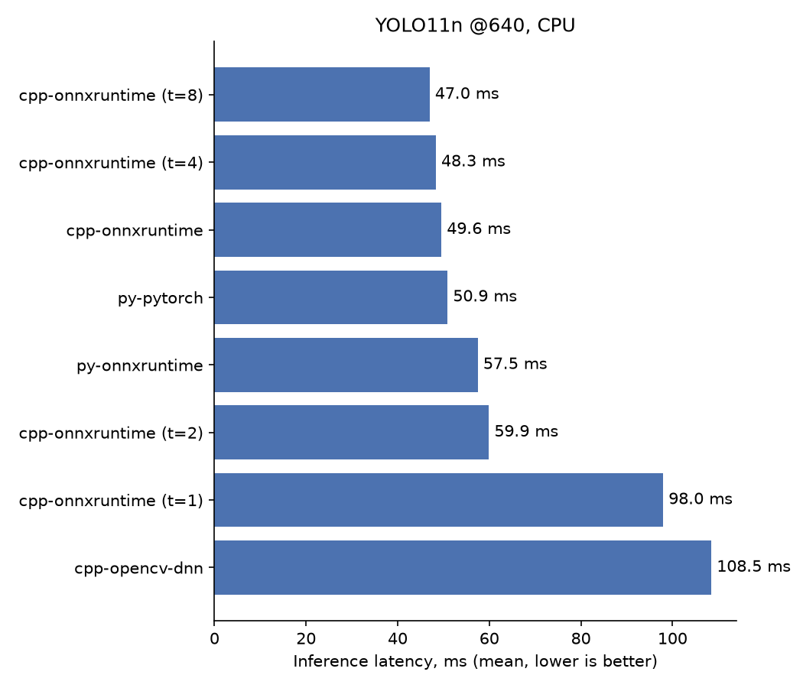

# YOLO → ONNX → C++: train in Python, deploy and benchmark in C++

End-to-end object-detection pipeline: fine-tune **YOLO11n** in Python (Ultralytics / PyTorch),
export to **ONNX**, and run it from a standalone **C++17** application with two interchangeable
backends: **ONNX Runtime** and **OpenCV DNN**. Includes accuracy-parity checks and latency benchmarks
(mean / p50 / p90 / p99, per-stage timing) against the Python baselines.


## Results

Hardware: Intel Core i7-6700HQ (4 cores / 8 threads, AVX2), Windows 10, laptop on AC power.
Model: YOLO11n fine-tuned on African Wildlife (4 classes), 640×640, batch 1, FP32.
200 timed iterations after 20 warm-up runs.

| runtime | threads | inference mean, ms | p50 | p90 | end-to-end, ms | FPS |
|---|---|---|---|---|---|---|
| C++ ONNX Runtime | 8 | 46.98 | 44.35 | 56.50 | 51.79 | 19.3 |
| C++ ONNX Runtime | 4 | 48.34 | 44.97 | 58.10 | 51.69 | 19.4 |
| C++ ONNX Runtime | default | 49.56 | 48.40 | 60.19 | 52.98 | 18.9 |
| Python PyTorch (Ultralytics) | default | 50.90 | 50.84 | 53.15 | 54.68 | 18.3 |
| Python ONNX Runtime (Ultralytics) | default | 57.49 | 57.41 | 61.12 | 62.15 | 16.1 |
| C++ ONNX Runtime | 2 | 59.92 | 58.90 | 62.50 | 62.97 | 15.9 |
| C++ ONNX Runtime | 1 | 97.96 | 96.22 | 105.39 | 100.75 | 9.9 |
| C++ OpenCV DNN 4.14 | default | 108.49 | 107.26 | 114.96 | 112.03 | 8.9 |



**Accuracy** (225 validation images, `python/check_parity.py`):
PyTorch mAP50-95 = 0.806, ONNX mAP50-95 = 0.801 (mAP50 0.959 vs 0.957), so the export is effectively lossless.

**Takeaways**
- **C++ ONNX Runtime is the fastest end-to-end pipeline**: 6% faster than PyTorch and 17% faster than
  ONNX Runtime driven from Python. Raw inference is close across runtimes because all of them execute
  native kernels; the C++ gain comes from a thin pre/post-processing layer (~4 ms, <8% of latency)
  and no interpreter overhead. The bigger win is deployment: one executable + two DLLs, no Python/PyTorch.
- **ONNX Runtime is 2.2× faster than OpenCV DNN** on the same ONNX graph (graph fusion + MLAS kernels).
  OpenCV 4.6 could not load YOLO11 at all (attention block); 4.12+ works.
- **Thread scaling is sub-linear**: 1 → 4 cores gives 2.0×; Hyper-Threading (8 threads) adds nothing
  measurable. Convolutions become memory-bandwidth bound.
- An earlier noisy run showed a p90 spike at 8 threads that disappeared on a clean machine, which shows
  why benchmarks should be repeated under controlled conditions before drawing conclusions.
  
  
## Pipeline

```
 dataset ──► train.py (PyTorch) ──► best.pt ──► export.py ──► best.onnx + classes.txt
                                       │                            │
                          check_parity.py (mAP PyTorch vs ONNX)     ▼
                                                     C++ yolo_infer
                                       letterbox ─► ORT / OpenCV DNN ─► decode + NMS
                                                            │
                                         benchmark.csv ─► make_report.py ─► table + chart
```

## Repository layout

```
python/   train.py, export.py, check_parity.py, benchmark.py, make_report.py
cpp/      CMakeLists.txt, include/, src/   (yolo_infer executable)
notebooks/train_colab.ipynb                 (training on a free Colab GPU)
scripts/run_bench.sh                        (all benchmarks -> results/)
results/  benchmark.csv, benchmark.md, latency.png, demo images
```

## Quick start

### 1. Python: train and export

```bash
python -m venv .venv && source .venv/bin/activate      # Windows: .venv\Scripts\activate
pip install -r requirements.txt
python python/train.py --data african-wildlife.yaml --epochs 50        # add --device 0 on GPU
python python/export.py --weights models/best.pt   # -> models/best.onnx
python python/check_parity.py --pt models/best.pt \
       --onnx models/best.onnx --data african-wildlife.yaml
```
No GPU? Use `notebooks/train_colab.ipynb` and download `best.pt`, `best.onnx`, `classes.txt`.

### 2. C++: build

Dependencies: CMake ≥ 3.16, a C++17 compiler, OpenCV (tested 4.12; for the **OpenCV DNN backend**
4.6 — the Ubuntu 24.04 apt version — fails to parse YOLO11's attention block, while the ONNX Runtime
backend works with it), and the ONNX Runtime prebuilt package from
[github.com/microsoft/onnxruntime/releases](https://github.com/microsoft/onnxruntime/releases)
(`onnxruntime-linux-x64-<ver>.tgz` or `onnxruntime-win-x64-<ver>.zip`).
If GitHub releases are unavailable, the same binaries ship in the NuGet package Microsoft.ML.OnnxRuntime (headers in build/native/include, libs in runtimes/win-x64/native).

Linux / WSL:
```bash
cmake -S cpp -B cpp/build -DCMAKE_BUILD_TYPE=Release -DONNXRUNTIME_DIR=$HOME/onnxruntime-linux-x64-<ver>
cmake --build cpp/build -j
```

Windows (Visual Studio 2022, x64 Native Tools prompt):
```bat
cmake -S cpp -B cpp\build -G "Visual Studio 17 2022" -A x64 ^
      -DOpenCV_DIR=C:\opencv\build ^
      -DONNXRUNTIME_DIR=C:\onnxruntime-win-x64-<ver>
cmake --build cpp\build --config Release
```
(add `C:\opencv\build\x64\vc16\bin` to `PATH` so the OpenCV DLL is found)

### 3. Run and benchmark

```bash
./cpp/build/yolo_infer --model models/best.onnx --image assets/test.jpg \
    --names models/classes.txt --backend ort --out results/demo_ort.jpg
./cpp/build/yolo_infer --model models/best.onnx --image assets/test.jpg --backend ort \
    --threads 4 --bench 200 --warmup 20
scripts/run_bench.sh models/best.pt models/best.onnx assets/test.jpg
```
Windows:
```bat
.\cpp\build\Release\yolo_infer.exe --model .\models\best.onnx --image .\assets\test.jpg ^
    --names .\models\classes.txt --backend ort --out .\results\demo_ort.jpg
```

## Implementation notes

- **Pre-processing** reproduces Ultralytics exactly: aspect-preserving resize + grey (114) letterbox,
  BGR→RGB, /255, HWC→NCHW. Mismatched pre-processing is the most common cause of accuracy loss
  after export, which `check_parity.py` guards against.
- **Output decoding**: YOLOv8/11 heads emit `[1, 4 + C, 8400]` (cx, cy, w, h + class scores, no
  objectness). The decoder reads the channel-major tensor in place (no transpose copy), maps boxes
  back through the letterbox and runs class-aware NMS (`cv::dnn::NMSBoxes` with per-class offsets).
- **Zero-copy input**: the ORT input tensor wraps the OpenCV blob memory directly.
- **Benchmark methodology**: Release build, warm-up runs excluded, per-stage timing with
  `std::chrono::steady_clock`, percentiles reported because tail latency matters for real-time use.
- **Backend abstraction**: `Detector` interface → `OrtDetector` / `OpenCVDetector`; adding TensorRT
  or OpenVINO is one new class.

## Possible extensions

- INT8 static quantisation (`onnxruntime.quantization`) and the speed/mAP trade-off.
- GPU: CUDA / TensorRT execution provider (`--cuda`), FP16 export (`export.py --half`).
- Video / webcam stream with a producer–consumer thread pipeline.
- Unit tests (GoogleTest) for letterbox and decoding; GitHub Actions CI build.
